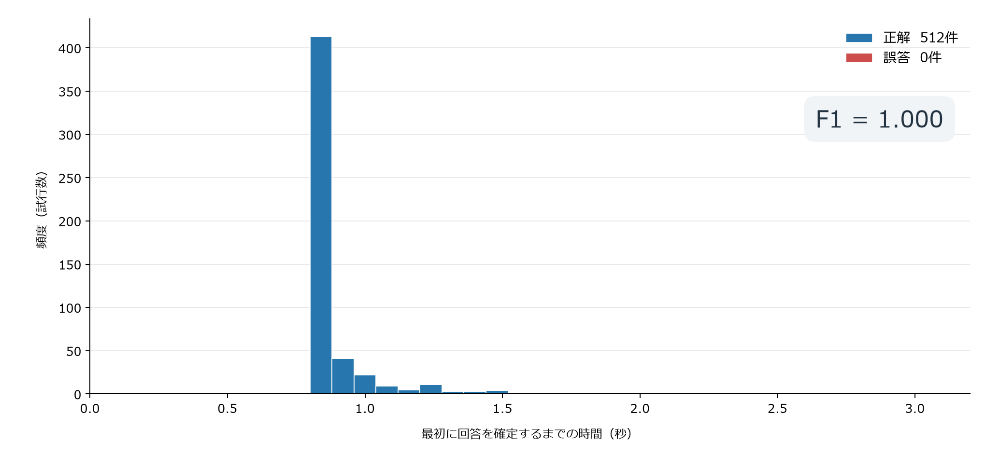

# ソルバー誘導AIの性能評価

通常秘話と強化秘話15系列を混ぜた512試行で、すべて正しい系列・鍵を特定しました。誤答・未回答は0件、F1は1.000です。

## 回答までの時間

| エンコーダー | 件数 | 1秒以内に正答 | 3秒以内に正答 | 誤答／未回答 | 最長の回答時間 |
|---|---:|---:|---:|---:|---:|
| ThumbDV | 256 | 219（85.5%） | 256（100%） | 0／0 | 1.80秒 |
| ambe2-c | 256 | 241（94.1%） | 256（100%） | 0／0 | 1.41秒 |

最初に採用した回答を採点しています。512件中511件が1.5秒以内、全件が1.8秒以内でした。後続の判定にも誤答はなく、3秒時点ですべて正答していました。

### 初回回答時間の分布



青は正答、赤は誤答、ビン幅は80 msです。今回は誤答0件です。[SVG版](figures/guided-ai-confirmation.svg)

時間は、80 msごとのバースト到着に実測処理時間を加え、処理の遅れを次のバーストへ持ち越した逐次入力の推定値です。モデルは事前ロード済みで、RF同期・USB待ち時間は含みません。

## 試験条件

- 音声：JSUT・LibriSpeechの評価用76発話から切り出した自然音声4.96秒。
- 設定：通常＋強化15系列に各16コード。系列ごとに日本語8件・英語8件、コード1・32767と乱数鍵を使用（seed 20261025）。
- 符号化：同じPCM・切り出し区間・系列・鍵をThumbDVとambe2-cで符号化し、256組×2＝512試行。追加の無音やFEC誤りは付与せず。
- 入力：1バーストずつ投入。採点用の系列・鍵・ファイル名はソルバーへ渡さず。
- 判定：線形スコア下限20、hybridの次点との差6。
- 環境：Core i7-14700K、RTX 4070 Ti SUPER、FP32 hybrid、TF32無効。

系列と表示コードの両方が一致した回答をTP、誤答をFP、未回答と誤答による正解の未検出をFNとし、`F1 = 2TP / (2TP + FP + FN)`を計算しました。試験集合は同じ76発話を複数の設定で使用しています。

## CPUでの処理速度

Core i7-14700KのCPUのみで、通常秘話・強化秘話・秘話なしを含む実録音8件を処理しました。各録音は最大62バーストです。

| スレッド数 | 1バースト平均 | 95パーセンタイル | 最大 | 正答 |
|---|---:|---:|---:|---:|
| 1 | 41.6 ms | 56.4 ms | 76.8 ms | 8/8 |
| 4 | 42.0 ms | 49.5 ms | 72.6 ms | 8/8 |

1スレッドでも80 msごとの入力に追いつく速度でした。モデルの初回ロード・ウォームアップは別途約1.31秒です。ノートPCでの測定は未実施です。

```powershell
python -m std_t98_cracker crack capture.burst --series auto --method guided-ai --device cpu --threads 1
```

## 実録音と別コーパスでの確認

| データ | 正答 | 途中の誤答 | 音声1秒分以内に正答 | 初回正答までの最大音声量 |
|---|---:|---:|---:|---:|
| CH1・通常3録音＋強化45録音 | 48/48 | 0 | 25/48 | 1.68秒 |
| ThumbDV・評価用169発話 | 169/169 | 0 | 152/169 | 2.56秒 |

この表の時間は入力バースト数×0.08秒で、処理時間を加えた上の512試行とは別の指標です。実録音48件は開発時にも使用しました。

169発話の試験は自然音声の先頭最大37バースト（2.96秒）を使い、系列0〜15と鍵を乱数で割り当てました。17件に1件は秘話なしです（seed 20261024）。閾値は20・6で固定しました。

[コーパスと再現手順](README.md) / [実機での系列検証](ENHANCED_RESULTS.md)
